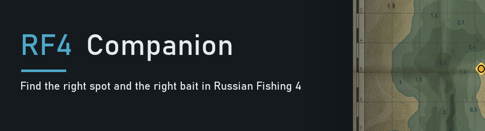
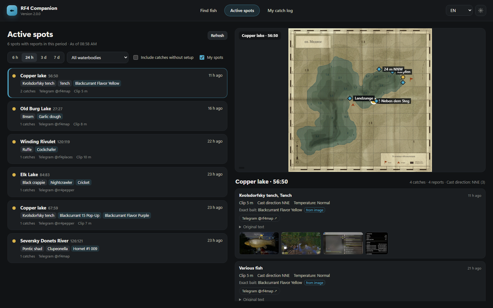
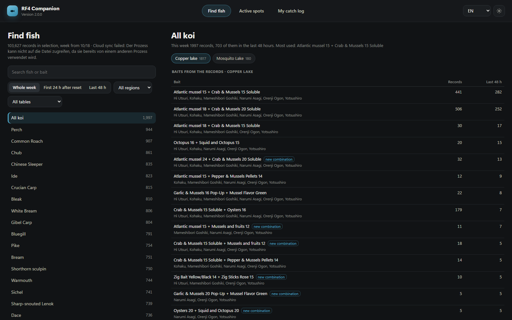

# RF4 Companion

**Find the right spot and the right bait in Russian Fishing 4.**

RF4 Companion is a free Windows tool that runs next to the game. It combines the official weekly records and community spot reports and shows in plain words where and with what to fish right now.

**Download:** [nalathan.itch.io/rf4-companion](https://nalathan.itch.io/rf4-companion) or the [latest release](https://github.com/Nalathan01/rf4-companion/releases/latest)

## Two areas

**Find fish.** Pick a fish or "All koi" and see where it was caught this week, with which baits and which spots are being reported right now. Waters are ranked by the last 48 hours, baits come straight from the weekly records of all regions, and bait combinations that were not in last week's records are marked as new. Filter by region, table and the first 24 hours after the weekly reset. A banner on Sunday evening tells you when the reset phase starts. The search box also finds baits and lists the fish caught on them.

**Active spots.** Every spot reported in the last 6 hours to 7 days, on the game map, sorted by how fresh it is. Only reports that name a real bait count: from the post text, from the setup screenshot in the post (read with Windows text recognition in all game languages) or from a matching entry in the official records. Each catch shows clip, depth, cast direction, water temperature, the original post text, the images and a link to the source, including the Discord server name and an invite. Reports on the Norwegian Sea are grouped by the depth marks of the map (34 m bank, 170 m and so on).

## More

* **Reference:** waterbodies with description and fish, trophy and rare trophy weights.
* **Websites:** quick links to other RF4 tools, including RF4 IT for the selected waterbody.
* **Text recognition packs:** install the Windows text recognition for further languages right from the settings.
* **16 languages**, the same as the game.
* **Updates itself:** new versions are downloaded from GitHub and checked by their SHA-256 hash before they replace the program.

## Requirements

* Windows 10 or 11 with Microsoft Edge (installed on every current Windows)
* For setup screenshots in posts: the Windows text recognition of the language in question (can be installed from the settings)

## Installation

1. Download `RF4Companion-Setup-<version>.exe` and run it.
2. Uninstall any time via the Windows settings.

Updating from version 1.x: run the new setup. It replaces the old version in the same folder. Your data in `%APPDATA%\RF4Companion` is kept.

## Privacy

Everything stays on your PC in `%APPDATA%\RF4Companion`. No account, no tracking, no telemetry. The app downloads public data only: the anonymised weekly records archive ([rf4-companion-data](https://github.com/Nalathan01/rf4-companion-data)), public community reports, the images and text of public Telegram posts, public Discord server names and the release information on GitHub. Spot facts (waterbody, position, fish, bait, clip, cast direction and the link to the source post) are prepared every 30 minutes on GitHub so the app starts fast; post texts and images are always loaded from the original source.

## Bug reports

Please report bugs only via [GitHub issues](https://github.com/Nalathan01/rf4-companion/issues). Comments on other download sites cannot be read or answered.

## Building

`build.ps1` compiles the program with the C# compiler that comes with Windows into a single exe. `Build-Release.ps1` additionally builds the setup and needs Inno Setup 6. Pushing a tag like `v2.0.0` builds both on GitHub and creates a draft release.

## Data sources and credits

* Weekly records: official record tables on rf4game.com, archived without player names.
* Community spots: [rf4intel.com](https://rf4intel.com), public reports from Telegram, Discord and VK.
* Spots from the Chinese WeChat community, telescopic records, trophy rarity and gear tables (rods, reels, lines, lures): [rf4.fish](https://rf4.fish) by ItsBlunty. Every spot links back to its rf4.fish page.
* Maps, fish and item names: Russian Fishing 4 by Fishsoft.

## Disclaimer

RF4 Companion is an unofficial fan tool. It is not affiliated with, endorsed by or connected to Fishsoft or Russian Fishing 4. All game names, maps and images belong to their respective owners. If you are a rights holder and want something removed, please open an issue.
